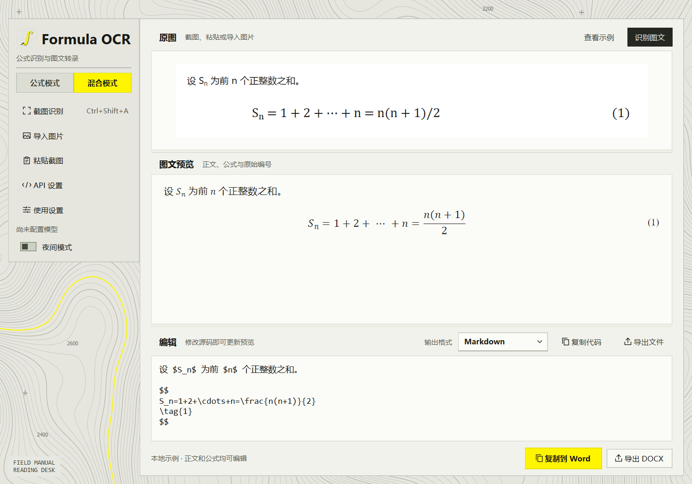
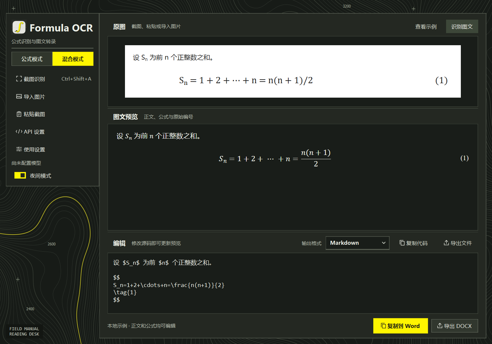

# Formula OCR

  [](LICENSE)

**截图识别数学公式，直接粘贴到 Word 继续编辑。** Formula OCR 是一款 Windows 桌面工具，也能识别论文截图里的正文、行内公式、独立公式和原始编号。识别使用你配置的视觉模型 API，预览和格式转换在本地完成。



<details>
<summary>查看夜间模式</summary>



</details>

## 安装与启动

**当前版本为 [Formula OCR 1.1](https://github.com/sakiii3321/MathFormulas_OCR/releases/tag/v1.1)**，提供两个 Windows 10/11 x64 单文件版本，任选一个即可，两者功能相同，均无需安装 Python。

| 版本与下载 | EXE 大小（约） | 运行依赖与选择建议 |
| --- | ---: | --- |
| [WebView2 轻量版](https://github.com/sakiii3321/MathFormulas_OCR/releases/download/v1.1/FormulaOCR-1.1-WebView2-Windows-x64.exe) | 54.9 MiB | 使用系统共享的 WebView2 Runtime；已安装或愿意安装该运行时的用户可选，下载更小 |
| [完整运行库版](https://github.com/sakiii3321/MathFormulas_OCR/releases/download/v1.1/FormulaOCR-1.1-Full-Windows-x64.exe) | 206.6 MiB | 内置 Python、Qt 和 Qt WebEngine 预览引擎，无需另装 WebView2 Runtime，适合希望下载后直接使用的用户 |

轻量版需要 [Microsoft WebView2 Runtime](https://developer.microsoft.com/microsoft-edge/webview2/#download-section)。缺少时程序会显示安装/修复入口；安装后重新启动即可。表中大小仅为应用下载包，不含共享运行时和使用时产生的缓存。

下载 EXE 后双击启动。首次使用在「API 设置」中配置视觉模型，也可先点击「查看示例」体验预览和导出。单文件版启动时会展开内置组件，请稍候。**两个版本的 OCR 都使用你配置的模型 API，完整运行库版不包含离线识别模型。**

升级前请先右键托盘图标选择「退出程序」，再启动新版。两版共用已有 API、快捷键和外观设置；同时运行会争用截图快捷键。[查看版本更新说明](CHANGELOG.md)，[历史版本](https://github.com/sakiii3321/MathFormulas_OCR/releases)。Release 附有 `SHA256SUMS.txt`，可用于校验下载文件。

### 从源码运行

需要 Windows 10 或 11 和 64 位 Python。建议使用 Python 3.12，确保 PowerShell 中可以运行 `python --version`。

```powershell
git clone https://github.com/sakiii3321/MathFormulas_OCR.git
cd MathFormulas_OCR
.\setup.cmd
.\run.cmd
```

也可以在 GitHub 下载源码 ZIP 并解压，首次双击 `setup.cmd` 安装依赖，之后双击 `run.cmd` 启动。想先看效果，可以在「混合模式」点击「查看示例」，直接体验编辑、预览和 Word 导出。

## 识别一张截图

1. 打开左栏「API 设置」，选择服务商并填写 API Key，以及账户可用的**视觉模型 ID**。
2. 只截一个公式时选「公式模式」，截取含正文、编号或插图的一段论文时选「混合模式」。
3. 按 **Ctrl+Shift+A**，拖动框选并松开，程序会把选区发送到配置的 API 识别。按 Esc 或右键可取消。也可以导入、拖入或粘贴图片，再点击识别。
4. 对照原图检查文字、上下标和公式编号。直接修改编辑区内容即可更新预览。点击「复制到 Word」，在桌面 Word 中保留源格式粘贴。

| 模式 | 适用内容 | 输出 |
| --- | --- | --- |
| 公式模式 | 单个公式、矩阵、多行公式 | 裸 LaTeX、行内或块级 LaTeX、`equation` 环境、MathML、Word 公式 |
| 混合模式 | 自然段、行内公式、独立公式、编号和裁剪插图 | Markdown、LaTeX、HTML、Word 富文本、含可编辑公式的 DOCX |

### 后台截图

默认开启「关闭窗口后驻留系统托盘」。点击窗口右上角的关闭按钮后，程序会驻留 Windows 任务栏右侧的系统托盘，截图快捷键继续有效。后台框选截图后，主窗口会显示并自动识别；按 Esc 或右键取消则保持隐藏，原有内容不变。

点击托盘图标可显示主窗口，右键菜单提供「显示主窗口」「截图识别」「使用设置」「退出程序」。常驻时关闭窗口不会中断正在进行的识别；选择「退出程序」后，如有识别请求，会等待请求结束再退出。在「使用设置」中取消常驻后，关闭窗口会退出程序，同样等待当前请求结束。

### 开机自启

在「使用设置」中勾选「开机自启（登录 Windows 后启动）」并保存。下次登录当前 Windows 账户时，程序会静默进入系统托盘，截图快捷键可直接使用；取消托盘常驻时，自启会显示主窗口。手动双击启动始终显示主窗口。

开机自启默认关闭，使用当前用户的 Windows 启动项，无需管理员权限。取消勾选并保存即可移除。完整运行库版、WebView2 轻量版和源码启动均支持，两版共用一个启动项，保存时使用当前运行版本的路径。移动 EXE 或源码目录后，请重新勾选并保存以更新启动路径。系统托盘不可用时会显示主窗口。

## API 配置

所有来源都使用支持 Base64 图片输入的 Chat Completions 接口。填写服务商控制台提供的完整模型 ID，普通文本模型无法读取截图。

| 来源 | 预设 Base URL | 模型填写方式 |
| --- | --- | --- |
| OpenAI | `https://api.openai.com/v1` | 账户可用的视觉模型 ID |
| 硅基流动 | `https://api.siliconflow.cn/v1` | 完整视觉模型 ID，包含组织前缀 |
| DeepSeek | `https://api.deepseek.com` | 程序预填 `deepseek-flash`，可按账户可用的视觉模型修改 |
| 自定义兼容接口 | 自行填写 | 支持图片输入的兼容模型，本机免鉴权服务可留空 Key |

**密钥和图片。** 默认仅在当前进程中使用密钥。勾选记住密钥后，程序通过 keyring 保存到 Windows 凭据管理器。识别会把当前图片发送给所选服务商，计费和数据处理规则以该服务商为准。

## 编辑与导出

混合模式用空行分段，行内公式用 `$…$`，独立公式前后的 `$$` 各占一行。例如：

```text
设 $S_n$ 为前 $n$ 个正整数之和。

$$
S_n = \frac{n(n+1)}{2}
\tag{1}
$$
```

- `\tag{1}` 保存原编号。输出到 Word 时，带编号的公式在段落中居中，编号使用右对齐制表位。
- 「导出 DOCX」将正文和原生 Word 公式写入文件，导出本身无需安装 Word。不同 Office 版本的粘贴效果可能不同，也可直接使用 DOCX。
- 插图按模型给出的区域从原图裁剪。导出含插图的 Markdown 或 LaTeX 时，请同时保留生成的 `_assets` 文件夹。
- 「使用设置」可修改截图快捷键，并为两种识别模式分别指定自动复制格式。左栏的夜间模式开关会记住上次选择。

使用 MathType 插件时，选择「MathML」并复制代码，再粘贴到 MathType 公式编辑器。MathML 导出和「复制到 Word」使用兼容的字符与字体样式表示，避免粗体向量字母乱码；软件预览仍保留浏览器所需的对齐样式。

## 支持范围

支持常见图片格式，每张上限 10 MB，转换为 PNG 后也会检查大小。截图选区限于一个显示器内。混合模式适合单栏截图，低清符号、阅读顺序和插图边界需要核对。程序按内容结构重新排版，复杂表格以裁剪图片保留。

## 测试与打包

### WebView2 轻量版

轻量版的预览使用共享 **WebView2 Runtime**，打包时排除 Qt WebEngine。运行时缺失时，识别、源码编辑和导出仍可使用。版本选择和下载链接见上方「安装与启动」。

```powershell
.\.venv\Scripts\python.exe -m pip install -r requirements-webview2.txt
.\.venv\Scripts\python.exe main_webview2.py
.\build-webview2.cmd
```

生成的单文件程序为 `dist\webview2\FormulaOCR-WebView2.exe`。预览桥接使用固定版本的 [SideView](https://github.com/AlexsanderMe/SideView)。浏览器数据保存在 `%LOCALAPPDATA%\FormulaOCR\WebView2`，不写入 EXE 所在目录。

Windows 桌面集成测试使用模拟 OCR，并在结束后恢复剪贴板：

```powershell
.\.venv\Scripts\python.exe tests\webview2_smoke.py
.\.venv\Scripts\python.exe tests\webview2_alignment_smoke.py
.\.venv\Scripts\python.exe tests\windows_capture_smoke.py --webview2
```

### 完整运行库版与自动测试

```powershell
.\.venv\Scripts\python.exe -m pip install pytest
.\.venv\Scripts\python.exe -m pytest -q
.\build.cmd
```

自动测试使用模拟 API 响应，无需真实密钥。默认目录版从 `dist\FormulaOCR\FormulaOCR.exe` 启动，分发时请提供整个 `dist\FormulaOCR` 目录。运行 `build.cmd onefile` 可生成可单独分发的 `dist\FormulaOCR.exe`。

## 许可证

本项目采用 [MIT 许可证](LICENSE)。
